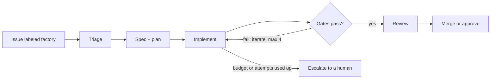

# Software Factory

An auditable software factory: GitHub issues go in, tested and reviewed changes
come out, and every step leaves a tamper-evident record of how the change was made.

Most agentic coding demos show an agent writing code. This project is about the
part regulated teams actually worry about: **who decided what, on what
evidence, and can you prove the record wasn't edited afterwards?**



Every transition writes an event to a hash-chained, append-only audit log in Postgres.

## Design principles

- **Deterministic orchestration.** Code owns the state machine, gates, budgets
  and merges. Models answer bounded questions inside steps; they never decide
  what happens next on their own. ([ADR 0001](docs/adr/0001-deterministic-orchestrator.md))
- **Evidence by construction.** A state change and its audit event commit in the
  same transaction. The chain is verifiable both inside Postgres and in plain C#.
  ([ADR 0003](docs/adr/0003-hash-chained-audit-log.md))
- **Infrastructure retries are not agent iteration.** A network blip is retried
  with backoff; failing tests become a new implement attempt with the failure as input.
- **Model tiers.** A decision layer (Jev or a constrained LLM) handles typed
  judgments with a confidence; small and frontier LLMs handle generation by tier.
- **Host-agnostic.** GitHub first, behind a forge adapter. ([ADR 0002](docs/adr/0002-github-first-forge-adapter.md))

Full design: [docs/design.md](docs/design.md).

## Status

| Milestone | Scope | State |
| --- | --- | --- |
| **M0 Skeleton** | Schema, hash-chained audit log, signed webhook intake, run state machine, CI | **In progress** |
| M1 Reliable core | Queue, leases, retries, DLQ, outbox, gates, iteration loop, decision layer | Planned |
| M2 Visible | Dashboard, DLQ replay, traceability report, cloud deploy with LB and CDN | Planned |
| M3 More intake | CI-failure and error-webhook intake, scheduled self-review | Planned |
| M4 Reference mode | Behavior traces from a reference app become issues and replay gates | Planned |
| M5 Scale story | Autoscaling workers, load test, read replica, sharding write-up | Planned |

**Target app:** a platform that turns a company's supplied information into a
website with a chatbot grounded in that information. The factory builds and
maintains the platform; chatbot answer quality is gated by eval suites.

## What works today (M0)

- `POST /webhooks/github` verifies the HMAC signature, ignores redeliveries,
  and turns an issue labeled `factory` into a requirement and a run.
- The orchestrator claims runs with `FOR UPDATE SKIP LOCKED` and moves them
  through the state machine, recording each transition.
- `GET /audit/verify` recomputes the whole chain twice, in Postgres and in C#,
  and reports the first broken event.
- The audit table rejects `UPDATE`, `DELETE` and `TRUNCATE`, including on
  individual partitions. If a privileged user disables that, the hash chain
  still pinpoints the edited event (see the integration tests).

## Run it locally

Requires Docker. The .NET 10 SDK is only needed to build outside Docker.

```bash
cp .env.example .env            # set GITHUB_WEBHOOK_SECRET
docker compose -f deploy/docker-compose.yml --env-file .env up --build

curl localhost:8080/healthz
GITHUB_WEBHOOK_SECRET=<your secret> scripts/send-test-webhook.sh
curl localhost:8080/audit/verify
```

Run the tests (integration tests need a Postgres the user can create databases on):

```bash
dotnet test
FACTORY_TEST_DB="Host=localhost;Username=factory;Password=factory;Database=factory" dotnet test
```

## Repository layout

```
src/
  Factory.Domain/          state machine, audit chain, retry policy, decision + forge interfaces
  Factory.Infrastructure/  Postgres stores, migrator, GitHub webhook handling
  Factory.Api/             webhook intake and read API
  Factory.Orchestrator/    run state machine driver
  Factory.Workers/         agent and gate step runners (M1)
db/migrations/             SQL schema, including the audit chain functions
gates/gates.yaml           gate thresholds and merge policy (CODEOWNERS-protected)
prompts/                   versioned prompts (CODEOWNERS-protected)
deploy/                    Dockerfile and docker compose stack
docs/                      design and architecture decision records
```

## License

[MIT](LICENSE)
